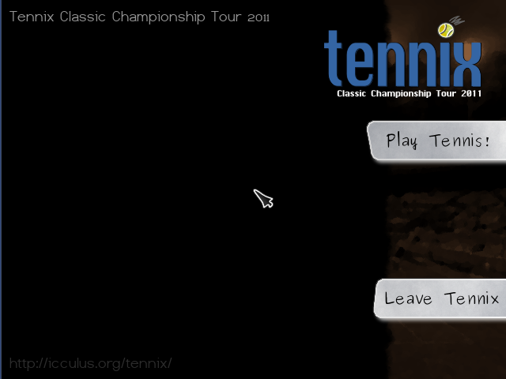
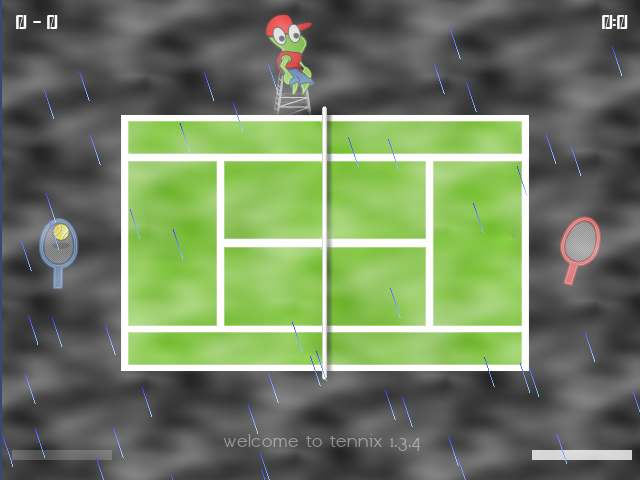
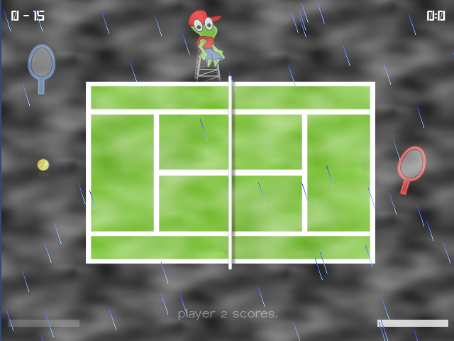

# Tennix for the Amiga

Tennis on your Amiga. Tennix (Classic Championship Tour 2011) by Thomas Perl
is a fast 2D tennis game: pick a stadium on the world map, from Melbourne to
New York, choose who plays (you, a friend on the same keyboard, or the
computer's Carl Van Court), and fight for the sets. Hold the hit key to
fill your power bar, and send the ball deep, with topspin, or as a smash.

This is the AmigaOS 3.x port, on OpenGPU's SDL 2, with the game's own free
graphics, sounds and fonts.

## Controls

The menus are played with the mouse: **Play**, then click a stadium on the
world map and the arrow, then set up the players (click a player's button
to change his controller) and click the arrow again.

| Controller           | Move       | Hit (hold for power) | Topspin    | Smash      |
|----------------------|------------|----------------------|------------|------------|
| Keyboard (arrows)    | Up / Down  | Space                | Left Ctrl  | Left Alt   |
| Keyboard (WS/DEF), player 1 only | W / S | D           | E          | F          |
| Keyboard (OL/KIJ), player 2 only | O / L | K           | I          | J          |
| Mouse                | follow the pointer up and down | left button | middle button | right button |
| Joystick or pad      | stick      | button 1             | button 2   | button 3   |

- **Esc** (or **Q**) during a match: back to the menu; the match is paused
  and **Resume** carries on with it (also after quitting the game).
- **Esc** (or **Q**) in the menu: quit. The credits roll; any key skips them.

## Requirements

- AmigaOS 3.x on a 68040 or 68060 with an FPU, and an RTG graphics card
  (a 640x480 window or screen in 16 bit or more).
- OpenGPU 0.6 or later (installed by OpenUp): opengpu.library and
  LIBS:OpenGPU/SDL2.module, SDL2_image.module and SDL2_mixer.module.
- About 16 MB of free memory.

## How to run

Copy the Tennix drawer anywhere and double-click **Tennix**. Or, from a
Shell:

    cd Tennix
    Tennix          ; in a window on the Workbench
    Tennix -f       ; full screen (640x480)

The game keeps its data (tennix.tnx) and a paused match in its own drawer.
See ReadMe (AMIGA_PORT.md) for what was changed for the Amiga, how to build
it, and the licences.

## Licence

Tennix is free software under the GNU GPL, version 2 or later (COPYING).
The stadium photos and the world map are public domain, the sounds are
public domain (MelodyLoops.com), and the fonts are GPL (data/COPYING).
SDL2_gfx's rotozoomer is under the zlib licence.
